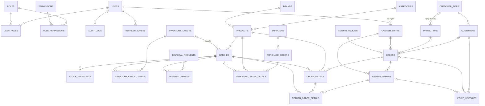

# ĐẶC TẢ CƠ SỞ DỮ LIỆU — HỆ THỐNG QUẢN LÝ CỬA HÀNG MỸ PHẨM (SE100)

> **Phiên bản: bản đề xuất** (đã áp dụng các sửa đổi trong [TOM_TAT_SUA_DOI.md](TOM_TAT_SUA_DOI.md)). Gồm **30 bảng** chia 5 cụm.
> Ký hiệu cột “Thay đổi”: **Mới** = cột/bảng thêm so với PDF · **Sửa** = đổi ràng buộc hoặc giá trị · để trống = giữ như PDF.
> Kiểu dữ liệu viết theo MySQL / SQL Server phổ thông. Mọi bảng dùng `PK` tự tăng (`AUTO_INCREMENT` / `IDENTITY`) trừ khi ghi khác.
> Sơ đồ ERD tương tác: trang **Sơ đồ ERD** trong [html/index.html](html/index.html).

## Mục lục

| Cụm | Bảng |
|---|---|
| 1. Hệ thống & phân quyền | [USERS](#1-users) · [ROLES](#2-roles) · [PERMISSIONS](#3-permissions) · [USER_ROLES](#4-user_roles) · [ROLE_PERMISSIONS](#5-role_permissions) · [AUDIT_LOGS](#6-audit_logs) · [SYSTEM_SETTINGS](#7-system_settings) · [REFRESH_TOKENS](#8-refresh_tokens) |
| 2. Sản phẩm & kho – lô – date | [CATEGORIES](#9-categories) · [BRANDS](#10-brands) · [PRODUCTS](#11-products) · [BATCHES](#12-batches) · [STOCK_MOVEMENTS](#13-stock_movements) · [INVENTORY_CHECKS](#14-inventory_checks) · [INVENTORY_CHECK_DETAILS](#15-inventory_check_details) · [DISPOSAL_REQUESTS](#16-disposal_requests) · [DISPOSAL_DETAILS](#17-disposal_details) |
| 3. Nhà cung cấp & nhập hàng | [SUPPLIERS](#18-suppliers) · [PURCHASE_ORDERS](#19-purchase_orders) · [PURCHASE_ORDER_DETAILS](#20-purchase_order_details) |
| 4. Khách hàng & khuyến mãi | [CUSTOMER_TIERS](#21-customer_tiers) · [CUSTOMERS](#22-customers) · [POINT_HISTORIES](#23-point_histories) · [PROMOTIONS](#24-promotions) |
| 5. Bán hàng, đổi trả & ca | [CASHIER_SHIFTS](#25-cashier_shifts) · [RETURN_POLICIES](#26-return_policies) · [ORDERS](#27-orders) · [ORDER_DETAILS](#28-order_details) · [RETURN_ORDERS](#29-return_orders) · [RETURN_ORDER_DETAILS](#30-return_order_details) |

Bảng **đã bỏ** so với PDF: `DISPOSAL_ALLOCATIONS`, `PROMOTION_USAGES`, `DAILY_SALES_REPORTS` (lý do ở [mục 9](#9-thay-đổi-so-với-pdf)).

---

## CỤM 1 · HỆ THỐNG & PHÂN QUYỀN

Mô hình RBAC: `USERS → USER_ROLES → ROLES → ROLE_PERMISSIONS → PERMISSIONS`.

### 1. USERS
Tài khoản nhân viên đăng nhập hệ thống.

| Cột | Kiểu | Ràng buộc | Mô tả | Thay đổi |
|---|---|---|---|---|
| user_id | INT | PK | Khóa chính | |
| employee_code | VARCHAR(20) | UNIQUE, NOT NULL | Mã nhân viên (NV0007) | Mới |
| username | VARCHAR(50) | UNIQUE, NOT NULL | Tên đăng nhập | |
| email | VARCHAR(100) | UNIQUE, NOT NULL | Email liên hệ / đăng nhập | |
| password_hash | VARCHAR(255) | NOT NULL | Mật khẩu băm BCrypt | |
| full_name | VARCHAR(100) | NOT NULL | Họ tên | |
| phone_number | VARCHAR(15) | NOT NULL | Số điện thoại | |
| status | VARCHAR(20) | NOT NULL, DEFAULT 'ACTIVE' | `ACTIVE`, `LOCKED` (Admin khóa) | |
| failed_login_count | INT | NOT NULL, DEFAULT 0 | Số lần nhập sai mật khẩu liên tiếp | Mới |
| locked_until | DATETIME | NULL | Khóa tạm đến thời điểm này (sai 5 lần → +15 phút) | Mới |
| must_change_password | BOOLEAN | NOT NULL, DEFAULT TRUE | Bắt đổi mật khẩu tạm ở lần đăng nhập đầu | Mới |
| last_login_at | DATETIME | NULL | Lần đăng nhập gần nhất | Mới |
| created_at | DATETIME | DEFAULT CURRENT_TIMESTAMP | Thời điểm tạo | |
| updated_at | DATETIME | NULL | Thời điểm sửa gần nhất | Mới |

### 2. ROLES
Vai trò / chức vụ.

| Cột | Kiểu | Ràng buộc | Mô tả | Thay đổi |
|---|---|---|---|---|
| role_id | INT | PK | Khóa chính | |
| role_code | VARCHAR(50) | UNIQUE, NOT NULL | `ADMIN`, `STORE_MANAGER`, `INVENTORY_STAFF`, `CASHIER` | Sửa: bỏ `SALE_STAFF` |
| role_name | VARCHAR(100) | NOT NULL | Tên hiển thị | |
| description | VARCHAR(255) | NULL | Mô tả nhiệm vụ | |
| is_system | BOOLEAN | NOT NULL, DEFAULT FALSE | Role mặc định: không được xóa; ADMIN không bị bỏ quyền quản trị | Mới |

### 3. PERMISSIONS
Quyền nguyên tử, **seed sẵn theo mã nguồn**, không tạo/xóa trên giao diện.

| Cột | Kiểu | Ràng buộc | Mô tả | Thay đổi |
|---|---|---|---|---|
| permission_id | INT | PK | Khóa chính | |
| permission_code | VARCHAR(100) | UNIQUE, NOT NULL | Mã quyền, vd `POS_CHECKOUT`, `STOCK_ADJUST_APPROVE`, `REPORT_PROFIT` | |
| permission_name | VARCHAR(100) | NOT NULL | Tên hiển thị trên ma trận tick quyền | Mới |
| module | VARCHAR(50) | NOT NULL | `AUTH`, `PRODUCT`, `INVENTORY`, `SUPPLIER`, `CUSTOMER`, `PROMOTION`, `POS`, `REPORT`, `SYSTEM` | |
| description | VARCHAR(255) | NULL | Diễn giải | |

### 4. USER_ROLES
| Cột | Kiểu | Ràng buộc | Mô tả |
|---|---|---|---|
| user_id | INT | PK, FK → USERS | Người dùng |
| role_id | INT | PK, FK → ROLES | Vai trò |

### 5. ROLE_PERMISSIONS
| Cột | Kiểu | Ràng buộc | Mô tả |
|---|---|---|---|
| role_id | INT | PK, FK → ROLES | Vai trò |
| permission_id | INT | PK, FK → PERMISSIONS | Quyền |

### 6. AUDIT_LOGS
Nhật ký thao tác. Cũng dùng để lưu lịch sử nâng hạng thẻ và thay đổi cấu hình (không tạo bảng riêng).

| Cột | Kiểu | Ràng buộc | Mô tả | Thay đổi |
|---|---|---|---|---|
| log_id | BIGINT | PK | Khóa chính | |
| user_id | INT | NULL, FK → USERS | Người thực hiện (NULL = hệ thống) | |
| action | VARCHAR(100) | NOT NULL | `LOGIN`, `LOGOUT`, `CREATE_PRODUCT`, `APPROVE_CHECK`, `CLOSE_SHIFT`, `TIER_UPGRADE`, `UPDATE_SETTING`… | |
| module | VARCHAR(50) | NOT NULL | Module phát sinh | |
| entity_type | VARCHAR(50) | NULL | Loại đối tượng bị tác động (`PRODUCT`, `SUPPLIER`, `ORDER`…) | Mới |
| entity_id | BIGINT | NULL | ID đối tượng | Mới |
| ip_address | VARCHAR(45) | NULL | IP client | Sửa tên (PDF ghi `ip_addres`) |
| details | TEXT (JSON) | NULL | Dữ liệu trước / sau khi đổi | |
| created_at | DATETIME | DEFAULT CURRENT_TIMESTAMP | Thời điểm ghi | |

### 7. SYSTEM_SETTINGS
**Bảng mới.** Tham số cấu hình dạng khóa – giá trị.

| Cột | Kiểu | Ràng buộc | Mô tả |
|---|---|---|---|
| setting_key | VARCHAR(50) | PK | Khóa cấu hình |
| setting_value | VARCHAR(255) | NOT NULL | Giá trị (lưu dạng chuỗi) |
| description | VARCHAR(255) | NULL | Diễn giải |
| updated_by | INT | NULL, FK → USERS | Người sửa gần nhất |
| updated_at | DATETIME | NULL | Thời điểm sửa |

Dữ liệu mặc định:

| setting_key | Giá trị mẫu | Ý nghĩa |
|---|---|---|
| EXPIRY_WARNING_DAYS | 60 | Ngưỡng N ngày cảnh báo cận hạn |
| POINT_EARN_AMOUNT | 10000 | Số tiền (VNĐ) khách trả để được 1 điểm |
| POINT_REDEEM_VALUE | 100 | Giá trị 1 điểm khi đổi (VNĐ) |
| POINT_MAX_REDEEM_PERCENT | 50 | Tối đa % giá trị đơn được trừ bằng điểm |
| STORE_NAME / STORE_ADDRESS / STORE_PHONE | … | In trên hóa đơn |

### 8. REFRESH_TOKENS
**Bảng mới.** Chỉ cần nếu dùng JWT; dùng session phía server thì bỏ.

| Cột | Kiểu | Ràng buộc | Mô tả |
|---|---|---|---|
| token_id | BIGINT | PK | Khóa chính |
| user_id | INT | NOT NULL, FK → USERS | Chủ phiên |
| token_hash | VARCHAR(255) | UNIQUE, NOT NULL | Băm của refresh token |
| expires_at | DATETIME | NOT NULL | Hết hạn |
| revoked_at | DATETIME | NULL | Thời điểm thu hồi (đăng xuất, bị khóa, đổi mật khẩu) |

---

## CỤM 2 · SẢN PHẨM & KHO – LÔ – DATE

### 9. CATEGORIES
| Cột | Kiểu | Ràng buộc | Mô tả | Thay đổi |
|---|---|---|---|---|
| category_id | INT | PK | Khóa chính | |
| category_code | VARCHAR(50) | UNIQUE, NOT NULL | Mã danh mục (CAT_SKINCARE) | |
| category_name | VARCHAR(100) | NOT NULL | Tên danh mục | |
| description | VARCHAR(255) | NULL | Mô tả | Mới |
| status | VARCHAR(20) | NOT NULL, DEFAULT 'ACTIVE' | `ACTIVE`, `INACTIVE` | |

### 10. BRANDS
| Cột | Kiểu | Ràng buộc | Mô tả | Thay đổi |
|---|---|---|---|---|
| brand_id | INT | PK | Khóa chính | |
| brand_code | VARCHAR(50) | UNIQUE, NOT NULL | Mã thương hiệu (LRP, CERAVE) | |
| brand_name | VARCHAR(100) | NOT NULL | Tên thương hiệu | |
| description | VARCHAR(255) | NULL | Mô tả | Mới |
| status | VARCHAR(20) | NOT NULL, DEFAULT 'ACTIVE' | `ACTIVE`, `INACTIVE` | |

### 11. PRODUCTS
Hồ sơ sản phẩm / SKU.

| Cột | Kiểu | Ràng buộc | Mô tả | Thay đổi |
|---|---|---|---|---|
| product_id | INT | PK | Khóa chính | |
| sku | VARCHAR(50) | UNIQUE, NOT NULL | Mã SKU | |
| barcode | VARCHAR(50) | UNIQUE, NULL | Mã vạch quét tại POS | |
| product_name | VARCHAR(255) | NOT NULL | Tên đầy đủ | |
| category_id | INT | NOT NULL, FK → CATEGORIES | Danh mục | |
| brand_id | INT | NOT NULL, FK → BRANDS | Thương hiệu | |
| unit | VARCHAR(20) | NOT NULL, DEFAULT 'Chai' | Đơn vị tính (Chai, Tuýp, Thỏi, Hộp). Không sửa khi đã có giao dịch | |
| volume | VARCHAR(30) | NULL | Quy cách (50ml, 236ml) | Mới |
| skin_type | VARCHAR(50) | NULL | Loại da phù hợp | |
| retail_price | DECIMAL(12,2) | NOT NULL, ≥ 0 | Giá bán niêm yết | |
| tax_rate | DECIMAL(4,2) | NOT NULL, DEFAULT 0.10 | Thuế suất VAT | |
| min_stock_alert | INT | NOT NULL, DEFAULT 5 | Ngưỡng tồn tối thiểu cảnh báo | |
| description | TEXT | NULL | Mô tả sản phẩm | Mới |
| image_url | VARCHAR(255) | NULL | Ảnh sản phẩm | Mới |
| status | VARCHAR(20) | NOT NULL, DEFAULT 'ACTIVE' | `ACTIVE`, `DISCONTINUED` | |
| created_at | DATETIME | DEFAULT CURRENT_TIMESTAMP | | Mới |
| updated_at | DATETIME | NULL | | Mới |

### 12. BATCHES
Lô hàng và hạn dùng. Trung tâm của nghiệp vụ kho.

| Cột | Kiểu | Ràng buộc | Mô tả | Thay đổi |
|---|---|---|---|---|
| batch_id | INT | PK | Khóa chính | |
| product_id | INT | NOT NULL, FK → PRODUCTS | Sản phẩm | |
| lot_code | VARCHAR(50) | NOT NULL, **UNIQUE(product_id, lot_code)** | Số lô in trên bao bì | Sửa: thêm UNIQUE |
| mfg_date | DATE | NULL | Ngày sản xuất | |
| exp_date | DATE | NOT NULL | Hạn dùng, cơ sở FEFO | |
| cost_price | DECIMAL(12,2) | NOT NULL | Giá vốn. Nhập thêm vào lô đã có → bình quân gia quyền | Sửa: cách tính |
| on_hand_qty | INT | NOT NULL, DEFAULT 0, ≥ 0 | Tồn thực tế | |
| blocked_qty | INT | NOT NULL, DEFAULT 0, 0 ≤ blocked ≤ on_hand | Lượng bị cách ly (hỏng, mở nắp, chờ hủy) | |
| locked_by_check_id | INT | NULL, FK → INVENTORY_CHECKS | Khác NULL = lô đang bị khóa kiểm kho | Mới |
| created_at | DATETIME | DEFAULT CURRENT_TIMESTAMP | Ngày lô vào kho lần đầu (tính tuổi tồn) | Mới |

Tồn bán được của lô: `on_hand_qty − blocked_qty`, chỉ khi `exp_date >= hôm nay` và `locked_by_check_id IS NULL`.

### 13. STOCK_MOVEMENTS
Thẻ kho: mọi tăng/giảm tồn đều có một dòng ở đây, ghi trong cùng transaction.

| Cột | Kiểu | Ràng buộc | Mô tả | Thay đổi |
|---|---|---|---|---|
| movement_id | BIGINT | PK | Khóa chính | |
| batch_id | INT | NOT NULL, FK → BATCHES | Lô bị biến động | |
| reference_type | VARCHAR(30) | NOT NULL | `PURCHASE`, `SALE`, `RETURN`, `CHECK_ADJUST`, `DISPOSAL` | Sửa: chuẩn hóa giá trị |
| reference_id | BIGINT | NOT NULL | ID chứng từ gốc (po_id, order_id, return_id, check_id, disposal_id). Không đặt FK vì trỏ nhiều bảng | |
| quantity_change | INT | NOT NULL, ≠ 0 | Có dấu: nhập/trả (+), bán/hủy (−), kiểm kho (±) | |
| balance_after | INT | NOT NULL | Tồn của lô sau biến động | Mới |
| reason | VARCHAR(255) | NULL | Ghi chú | |
| created_by | INT | NULL, FK → USERS | Người thực hiện | Mới |
| created_at | DATETIME | DEFAULT CURRENT_TIMESTAMP | Thời điểm | |

### 14. INVENTORY_CHECKS
Phiếu kiểm kho.

| Cột | Kiểu | Ràng buộc | Mô tả | Thay đổi |
|---|---|---|---|---|
| check_id | INT | PK | Khóa chính | |
| check_code | VARCHAR(50) | UNIQUE, NOT NULL | Mã phiếu (CHK20261003-01) | |
| scope_note | VARCHAR(255) | NULL | Mô tả phạm vi (phạm vi thực tế = tập lô trong DETAILS) | Mới |
| status | VARCHAR(30) | NOT NULL, DEFAULT 'IN_PROGRESS' | `IN_PROGRESS`, `WAITING_APPROVAL`, `APPROVED`, `REJECTED`, `CANCELLED`, `NO_DIFFERENCE` | Sửa: thêm 2 trạng thái |
| snapshot_at | DATETIME | NOT NULL | Thời điểm chụp tồn sổ sách | |
| created_by | INT | NOT NULL, FK → USERS | Nhân viên kho lập phiếu | |
| submitted_at | DATETIME | NULL | Thời điểm gửi duyệt | Mới |
| approved_by | INT | NULL, FK → USERS | Quản lý duyệt / từ chối | |
| approved_at | DATETIME | NULL | Thời điểm duyệt / từ chối | Mới |
| reject_reason | TEXT | NULL | Lý do từ chối | Mới |

### 15. INVENTORY_CHECK_DETAILS
| Cột | Kiểu | Ràng buộc | Mô tả | Thay đổi |
|---|---|---|---|---|
| check_detail_id | INT | PK | Khóa chính | |
| check_id | INT | NOT NULL, FK → INVENTORY_CHECKS | Phiếu kiểm | |
| batch_id | INT | NOT NULL, FK → BATCHES; UNIQUE(check_id, batch_id) | Lô được đếm | |
| snapshot_qty | INT | NOT NULL | Tồn sổ sách lúc chụp | |
| counted_qty | INT | NULL khi đang đếm, bắt buộc khi gửi duyệt, ≥ 0 | Số đếm thực tế | Sửa: cho phép NULL |
| difference_qty | INT | NULL đến khi gửi duyệt | `counted_qty − snapshot_qty` | Sửa |
| note | VARCHAR(255) | NULL | Giải trình chênh lệch | |

### 16. DISPOSAL_REQUESTS
Phiếu đề nghị xuất hủy.

| Cột | Kiểu | Ràng buộc | Mô tả | Thay đổi |
|---|---|---|---|---|
| disposal_id | INT | PK | Khóa chính | |
| disposal_code | VARCHAR(50) | UNIQUE, NOT NULL | Mã phiếu (DISP20261005-01) | |
| status | VARCHAR(30) | NOT NULL, DEFAULT 'WAITING_APPROVAL' | `WAITING_APPROVAL`, `APPROVED` (đã trừ tồn), `REJECTED` | Sửa: bỏ `APPROVED_PENDING`, `COMPLETED` |
| reason | TEXT | NOT NULL | Lý do chung | |
| requested_by | INT | NOT NULL, FK → USERS | Nhân viên kho lập | |
| created_at | DATETIME | DEFAULT CURRENT_TIMESTAMP | Ngày lập | |
| approved_by | INT | NULL, FK → USERS | Quản lý duyệt / từ chối | |
| approved_at | DATETIME | NULL | Thời điểm duyệt / từ chối | Mới |
| reject_reason | TEXT | NULL | Lý do từ chối | Mới |

### 17. DISPOSAL_DETAILS
| Cột | Kiểu | Ràng buộc | Mô tả | Thay đổi |
|---|---|---|---|---|
| disposal_detail_id | INT | PK | Khóa chính | |
| disposal_id | INT | NOT NULL, FK → DISPOSAL_REQUESTS | Phiếu hủy | |
| batch_id | INT | NOT NULL, FK → BATCHES | Lô bị hủy | |
| quantity | INT | NOT NULL, > 0 | Số lượng hủy | |
| blocked_added_qty | INT | NOT NULL, DEFAULT 0 | Lượng hệ thống cách ly thêm khi lập phiếu (trả lại nếu từ chối) | Mới (thay DISPOSAL_ALLOCATIONS) |
| unit_cost | DECIMAL(12,2) | NULL | Giá vốn lô, chụp lúc duyệt (báo cáo tổn thất) | Mới |
| item_reason | VARCHAR(255) | NULL | Lý do riêng từng lô | |

---

## CỤM 3 · NHÀ CUNG CẤP & NHẬP HÀNG

### 18. SUPPLIERS
| Cột | Kiểu | Ràng buộc | Mô tả | Thay đổi |
|---|---|---|---|---|
| supplier_id | INT | PK | Khóa chính | |
| supplier_code | VARCHAR(50) | UNIQUE, NOT NULL | Mã NCC, hệ thống sinh (NCC003) | |
| supplier_name | VARCHAR(255) | NOT NULL | Tên công ty | |
| tax_code | VARCHAR(50) | UNIQUE, NULL | Mã số thuế | |
| phone_number | VARCHAR(15) | UNIQUE, NOT NULL | SĐT liên hệ | Sửa: thêm UNIQUE |
| email | VARCHAR(100) | UNIQUE, NULL | Email đặt hàng | Sửa: thêm UNIQUE |
| address | VARCHAR(255) | NOT NULL | Địa chỉ | Mới |
| contact_person | VARCHAR(100) | NULL | Người đại diện liên hệ | Mới |
| note | TEXT | NULL | Ghi chú chính sách chiết khấu | Mới |
| status | VARCHAR(20) | NOT NULL, DEFAULT 'ACTIVE' | `ACTIVE`, `INACTIVE` | |
| created_at | DATETIME | DEFAULT CURRENT_TIMESTAMP | | Mới |
| updated_at | DATETIME | NULL | | Mới |

~~debt_limit~~ đã bỏ (không quản lý công nợ).

### 19. PURCHASE_ORDERS
Phiếu nhập kho (một bước: nháp → hoàn tất, không có bước đặt hàng).

| Cột | Kiểu | Ràng buộc | Mô tả | Thay đổi |
|---|---|---|---|---|
| po_id | INT | PK | Khóa chính | |
| po_code | VARCHAR(50) | UNIQUE, NOT NULL | Mã phiếu (PN20260928-01) | |
| supplier_id | INT | NOT NULL, FK → SUPPLIERS | NCC (chỉ chọn NCC ACTIVE) | |
| supplier_invoice_no | VARCHAR(50) | NULL | Số hóa đơn của NCC | Mới |
| total_amount | DECIMAL(14,2) | NOT NULL, DEFAULT 0 | Σ line_total | |
| status | VARCHAR(30) | NOT NULL, **DEFAULT 'DRAFT'** | `DRAFT`, `COMPLETED`, `CANCELLED` | Sửa: PDF mặc định COMPLETED |
| note | TEXT | NULL | Ghi chú | Mới |
| created_by | INT | NOT NULL, FK → USERS | Nhân viên kho | |
| created_at | DATETIME | DEFAULT CURRENT_TIMESTAMP | Ngày tạo | |
| confirmed_at | DATETIME | NULL | Thời điểm xác nhận nhập kho | Mới |

~~paid_amount~~, ~~debt_amount~~ đã bỏ.

### 20. PURCHASE_ORDER_DETAILS
**Bảng mới.** Mỗi dòng là một lô nhập.

| Cột | Kiểu | Ràng buộc | Mô tả |
|---|---|---|---|
| po_detail_id | INT | PK | Khóa chính |
| po_id | INT | NOT NULL, FK → PURCHASE_ORDERS | Phiếu nhập |
| product_id | INT | NOT NULL, FK → PRODUCTS | Sản phẩm |
| lot_code | VARCHAR(50) | NOT NULL | Mã lô |
| mfg_date | DATE | NULL | Ngày sản xuất |
| exp_date | DATE | NOT NULL, > ngày nhập | Hạn dùng |
| quantity | INT | NOT NULL, > 0 | Số lượng thực nhận |
| unit_cost | DECIMAL(12,2) | NOT NULL, ≥ 0 | Giá nhập |
| line_total | DECIMAL(14,2) | NOT NULL | quantity × unit_cost |
| batch_id | INT | NULL, FK → BATCHES | NULL khi phiếu nháp; gán khi xác nhận |

---

## CỤM 4 · KHÁCH HÀNG & KHUYẾN MÃI

### 21. CUSTOMER_TIERS
| Cột | Kiểu | Ràng buộc | Mô tả | Thay đổi |
|---|---|---|---|---|
| tier_id | INT | PK | Khóa chính | |
| tier_code | VARCHAR(20) | UNIQUE, NOT NULL | `BRONZE`, `SILVER`, `GOLD`, `DIAMOND` | Mới |
| tier_name | VARCHAR(50) | UNIQUE, NOT NULL | Tên hiển thị (Đồng, Bạc…) | |
| min_spend | DECIMAL(14,2) | UNIQUE, NOT NULL, ≥ 0 | Mốc chi tiêu lũy kế. Hạng mặc định có min_spend = 0 | Sửa: thêm UNIQUE |
| discount_rate | DECIMAL(4,2) | NOT NULL, DEFAULT 0 | Chiết khấu tự động khi mua (0.03 = 3%) | |

### 22. CUSTOMERS
| Cột | Kiểu | Ràng buộc | Mô tả | Thay đổi |
|---|---|---|---|---|
| customer_id | INT | PK | Khóa chính | |
| customer_code | VARCHAR(50) | UNIQUE, NOT NULL | Mã KH, hệ thống sinh (KH0042) | |
| phone_number | VARCHAR(15) | UNIQUE, NOT NULL | Khóa tra cứu tại POS | |
| full_name | VARCHAR(100) | NOT NULL | Họ tên | |
| email | VARCHAR(100) | NULL | Email | Mới |
| date_of_birth | DATE | NULL | Ngày sinh | Mới |
| gender | VARCHAR(10) | NULL | `MALE`, `FEMALE`, `OTHER` | Mới |
| address | VARCHAR(255) | NULL | Địa chỉ | Mới |
| skin_type | VARCHAR(50) | NULL | Loại da | |
| note | TEXT | NULL | Ghi chú | Mới |
| tier_id | INT | NOT NULL, FK → CUSTOMER_TIERS | Hạng hiện tại | |
| reward_points | INT | NOT NULL, DEFAULT 0, ≥ 0 | Điểm khả dụng | |
| total_spent | DECIMAL(14,2) | NOT NULL, DEFAULT 0 | Chi tiêu lũy kế (trừ khi trả hàng) | |
| status | VARCHAR(20) | NOT NULL, DEFAULT 'ACTIVE' | `ACTIVE`, `INACTIVE` (khóa ưu đãi) | |
| created_at | DATETIME | DEFAULT CURRENT_TIMESTAMP | Báo cáo khách mới | Mới |
| updated_at | DATETIME | NULL | | Mới |

### 23. POINT_HISTORIES
| Cột | Kiểu | Ràng buộc | Mô tả | Thay đổi |
|---|---|---|---|---|
| point_id | BIGINT | PK | Khóa chính | |
| customer_id | INT | NOT NULL, FK → CUSTOMERS | Khách hàng | |
| order_id | INT | NULL, FK → ORDERS | Đơn phát sinh (EARN, REDEEM) | |
| return_id | INT | NULL, FK → RETURN_ORDERS | Phiếu trả phát sinh (REVOKE) | Mới |
| action_type | VARCHAR(30) | NOT NULL | `EARN`, `REDEEM`, `REVOKE`, `ADJUST` | Sửa: PDF chỉ có EARNED, REFUNDED |
| points_changed | INT | NOT NULL | Có dấu (+ / −) | |
| balance_after | INT | NOT NULL | Điểm còn lại sau giao dịch | Mới |
| created_at | DATETIME | DEFAULT CURRENT_TIMESTAMP | | |

### 24. PROMOTIONS
Voucher cấp đơn hàng, **1 voucher/đơn**.

| Cột | Kiểu | Ràng buộc | Mô tả | Thay đổi |
|---|---|---|---|---|
| promotion_id | INT | PK | Khóa chính | |
| voucher_code | VARCHAR(50) | UNIQUE, NOT NULL | Mã nhập tại POS (THU2026) | |
| promotion_name | VARCHAR(255) | NOT NULL | Tên chương trình | |
| description | TEXT | NULL | Mô tả | Mới |
| discount_type | VARCHAR(20) | NOT NULL | `PERCENT`, `FIXED_AMOUNT` | |
| discount_value | DECIMAL(12,2) | NOT NULL, > 0 (PERCENT ≤ 100) | Mức giảm | |
| max_discount_amount | DECIMAL(12,2) | NULL | Trần giảm cho loại % | |
| min_order_value | DECIMAL(12,2) | NOT NULL, DEFAULT 0 | Đơn tối thiểu (so với tiền sau chiết khấu hạng) | |
| min_tier_id | INT | NULL, FK → CUSTOMER_TIERS | Hạng thẻ tối thiểu; khác NULL thì bắt buộc có khách | Mới |
| start_date | DATE | NOT NULL | Ngày bắt đầu | |
| end_date | DATE | NOT NULL, ≥ start_date | Ngày kết thúc | |
| usage_limit | INT | NULL = không giới hạn | Tổng lượt dùng | Sửa: cho NULL |
| limit_per_customer | INT | NULL = không giới hạn, ≤ usage_limit | Lượt/khách; khác NULL thì bắt buộc có khách | Sửa: cho NULL |
| status | VARCHAR(20) | NOT NULL, DEFAULT 'ACTIVE' | Chỉ `ACTIVE`, `PAUSED`. “Sắp diễn ra / Đã kết thúc” tính theo ngày | Sửa |
| created_by | INT | NOT NULL, FK → USERS | Người tạo | Mới |
| created_at | DATETIME | DEFAULT CURRENT_TIMESTAMP | | Mới |
| updated_at | DATETIME | NULL | | Mới |

~~is_stackable~~ đã bỏ. Số lượt đã dùng = `COUNT(ORDERS COMPLETED có promotion_id)`.

---

## CỤM 5 · BÁN HÀNG, ĐỔI TRẢ & CA

### 25. CASHIER_SHIFTS
| Cột | Kiểu | Ràng buộc | Mô tả | Thay đổi |
|---|---|---|---|---|
| shift_id | INT | PK | Khóa chính | |
| shift_code | VARCHAR(30) | UNIQUE, NOT NULL | Mã ca (CA20261005-02) | Mới |
| cashier_id | INT | NOT NULL, FK → USERS | Thu ngân | |
| opened_at | DATETIME | NOT NULL | Giờ mở ca | |
| opening_cash | DECIMAL(12,2) | NOT NULL, DEFAULT 0, ≥ 0 | Tiền đầu ca | |
| closed_at | DATETIME | NULL | Giờ chốt ca | |
| expected_cash | DECIMAL(12,2) | NULL | Đầu ca + thu tiền mặt − chi hoàn tiền mặt | |
| actual_cash | DECIMAL(12,2) | NULL, ≥ 0 | Tiền thực đếm | |
| difference_amount | DECIMAL(12,2) | NULL | actual − expected | |
| note | TEXT | NULL, bắt buộc khi difference ≠ 0 | Giải trình | |
| status | VARCHAR(20) | NOT NULL, DEFAULT 'OPEN' | `OPEN`, `CLOSED` | |
| handover_confirmed_by | INT | NULL, FK → USERS | Quản lý xác nhận bàn giao | Mới |

Ràng buộc nghiệp vụ: mỗi `cashier_id` tối đa 1 ca `OPEN` (kiểm ở tầng ứng dụng hoặc unique index có điều kiện nếu CSDL hỗ trợ).

### 26. RETURN_POLICIES
| Cột | Kiểu | Ràng buộc | Mô tả | Thay đổi |
|---|---|---|---|---|
| policy_id | INT | PK | Khóa chính | |
| policy_name | VARCHAR(100) | NOT NULL | Tên (Tiêu chuẩn 7 ngày) | |
| max_return_days | INT | NOT NULL, DEFAULT 7 | Số ngày được trả kể từ ngày mua | |
| is_refund_allowed | BOOLEAN | NOT NULL, DEFAULT TRUE | FALSE = chỉ đổi hàng | |
| restocking_fee_percent | DECIMAL(4,2) | NOT NULL, DEFAULT 0 | Phí trả hàng | |
| is_default | BOOLEAN | NOT NULL, DEFAULT FALSE | Chính sách gắn mặc định cho đơn mới (chỉ 1 dòng TRUE) | Mới |
| status | VARCHAR(20) | NOT NULL, DEFAULT 'ACTIVE' | `ACTIVE`, `INACTIVE` | Mới |

### 27. ORDERS
Hóa đơn bán hàng.

| Cột | Kiểu | Ràng buộc | Mô tả | Thay đổi |
|---|---|---|---|---|
| order_id | INT | PK | Khóa chính | |
| order_code | VARCHAR(50) | UNIQUE, NOT NULL | Mã hóa đơn (HD20261005-0015) | |
| shift_id | INT | NOT NULL, FK → CASHIER_SHIFTS | Ca ghi nhận | |
| cashier_id | INT | NOT NULL, FK → USERS | Thu ngân lập đơn | |
| customer_id | INT | NULL, FK → CUSTOMERS | NULL = khách vãng lai | |
| policy_id | INT | NOT NULL, FK → RETURN_POLICIES | Chính sách đổi trả áp cho đơn | |
| promotion_id | INT | NULL, FK → PROMOTIONS | Voucher đã áp | Mới (thay PROMOTION_USAGES) |
| subtotal_amount | DECIMAL(12,2) | NOT NULL | Σ unit_price × quantity | |
| tier_discount_amount | DECIMAL(12,2) | NOT NULL, DEFAULT 0 | Chiết khấu hạng thẻ | Mới |
| voucher_discount_amount | DECIMAL(12,2) | NOT NULL, DEFAULT 0 | Giảm từ voucher | Mới |
| points_used | INT | NOT NULL, DEFAULT 0 | Số điểm khách dùng | Mới |
| points_discount_amount | DECIMAL(12,2) | NOT NULL, DEFAULT 0 | Tiền giảm từ điểm | Mới |
| discount_amount | DECIMAL(12,2) | NOT NULL, DEFAULT 0 | Tổng 3 khoản giảm trên | |
| tax_amount | DECIMAL(12,2) | NOT NULL, DEFAULT 0 | Tiền VAT | |
| total_amount | DECIMAL(12,2) | NOT NULL | Khách phải trả | |
| payment_method | VARCHAR(20) | **NULL** đến khi hoàn tất | `CASH`, `BANK_TRANSFER`, `CARD` | Sửa: PDF NOT NULL |
| amount_received | DECIMAL(12,2) | NULL | Tiền khách đưa (tiền mặt) | Mới |
| change_due | DECIMAL(12,2) | NULL | Tiền thừa | Mới |
| status | VARCHAR(30) | NOT NULL, DEFAULT 'DRAFT' | `DRAFT`, `COMPLETED`, `CANCELLED` | Sửa: PDF dùng WAITING_FOR_PAYMENT |
| created_at | DATETIME | DEFAULT CURRENT_TIMESTAMP | Lúc tạo đơn | |
| completed_at | DATETIME | NULL | Lúc hoàn tất; **báo cáo doanh thu tính theo cột này** | Mới |

~~salesperson_id~~ đã bỏ.

### 28. ORDER_DETAILS
Dòng hàng bán, mỗi dòng gắn **một lô**. Lưu giá vốn tại thời điểm bán.

| Cột | Kiểu | Ràng buộc | Mô tả | Thay đổi |
|---|---|---|---|---|
| order_detail_id | BIGINT | PK | Khóa chính | |
| order_id | INT | NOT NULL, FK → ORDERS | Hóa đơn | |
| product_id | INT | NOT NULL, FK → PRODUCTS | Sản phẩm | |
| batch_id | INT | NOT NULL, FK → BATCHES | Lô xuất theo FEFO | |
| quantity | INT | NOT NULL, > 0 | Số lượng | |
| unit_price | DECIMAL(12,2) | NOT NULL | Giá bán lúc lập đơn | |
| cost_price | DECIMAL(12,2) | NOT NULL | Giá vốn của lô (COGS) | |
| tax_rate | DECIMAL(4,2) | NOT NULL | Thuế suất lúc bán | Mới |
| tax_amount | DECIMAL(12,2) | NOT NULL, DEFAULT 0 | VAT của dòng | |
| discount_allocated | DECIMAL(12,2) | NOT NULL, DEFAULT 0 | Phần giảm giá cấp đơn phân bổ theo tỷ lệ tiền dòng | Mới |
| line_total | DECIMAL(12,2) | NOT NULL | quantity × unit_price − discount_allocated | Mới |

### 29. RETURN_ORDERS
Phiếu đổi trả. Nhận hàng và hoàn tiền là **một giao dịch**.

| Cột | Kiểu | Ràng buộc | Mô tả | Thay đổi |
|---|---|---|---|---|
| return_id | INT | PK | Khóa chính | |
| return_code | VARCHAR(50) | UNIQUE, NOT NULL | Mã phiếu (RET20261007-0003) | |
| original_order_id | INT | NOT NULL, FK → ORDERS | Hóa đơn gốc (phải COMPLETED) | |
| shift_id | INT | NOT NULL, FK → CASHIER_SHIFTS | Ca **hiện tại** chi tiền | |
| processed_by | INT | NOT NULL, FK → USERS | Thu ngân xử lý | |
| return_reason | TEXT | NOT NULL | Lý do | |
| restocking_fee_amount | DECIMAL(12,2) | NOT NULL, DEFAULT 0 | Phí trả hàng đã trừ | Mới |
| total_refund_amount | DECIMAL(12,2) | NOT NULL | Tiền hoàn thực tế | |
| refund_method | VARCHAR(20) | NOT NULL | `CASH`, `BANK_TRANSFER` | |
| points_revoked | INT | NOT NULL, DEFAULT 0 | Điểm bị thu hồi | Mới |
| status | VARCHAR(30) | NOT NULL, DEFAULT 'COMPLETED' | `COMPLETED`, `CANCELLED` | Sửa: bỏ WAITING_FOR_REFUND, REJECTED |
| created_at | DATETIME | DEFAULT CURRENT_TIMESTAMP | Ngày trả (báo cáo trừ vào ngày này) | |

### 30. RETURN_ORDER_DETAILS
| Cột | Kiểu | Ràng buộc | Mô tả | Thay đổi |
|---|---|---|---|---|
| return_detail_id | INT | PK | Khóa chính | |
| return_id | INT | NOT NULL, FK → RETURN_ORDERS | Phiếu trả | |
| order_detail_id | BIGINT | NOT NULL, FK → ORDER_DETAILS | Dòng hàng gốc | Mới |
| batch_id | INT | NOT NULL, FK → BATCHES | Lô nhận lại (= lô của dòng gốc) | |
| quantity | INT | NOT NULL, > 0 | Σ theo order_detail_id ≤ quantity dòng gốc | |
| refund_unit_price | DECIMAL(12,2) | NOT NULL | line_total / quantity của dòng gốc | |
| unit_cost | DECIMAL(12,2) | NOT NULL | cost_price của dòng gốc (trừ COGS) | Mới |
| item_condition | VARCHAR(30) | NOT NULL | `INTACT`, `DAMAGED_OR_OPENED` (→ tăng blocked_qty) | |

---

## 6. Danh sách quan hệ (khóa ngoại)

Tất cả là quan hệ **1 – n** (bảng bên trái là “1”).

| Bảng cha (1) | Bảng con (n) · cột FK |
|---|---|
| USERS | USER_ROLES.user_id · REFRESH_TOKENS.user_id · AUDIT_LOGS.user_id · SYSTEM_SETTINGS.updated_by · CASHIER_SHIFTS.cashier_id · CASHIER_SHIFTS.handover_confirmed_by · ORDERS.cashier_id · RETURN_ORDERS.processed_by · STOCK_MOVEMENTS.created_by · INVENTORY_CHECKS.created_by / approved_by · DISPOSAL_REQUESTS.requested_by / approved_by · PURCHASE_ORDERS.created_by · PROMOTIONS.created_by |
| ROLES | USER_ROLES.role_id · ROLE_PERMISSIONS.role_id |
| PERMISSIONS | ROLE_PERMISSIONS.permission_id |
| CATEGORIES | PRODUCTS.category_id |
| BRANDS | PRODUCTS.brand_id |
| PRODUCTS | BATCHES.product_id · PURCHASE_ORDER_DETAILS.product_id · ORDER_DETAILS.product_id |
| BATCHES | STOCK_MOVEMENTS.batch_id · INVENTORY_CHECK_DETAILS.batch_id · DISPOSAL_DETAILS.batch_id · PURCHASE_ORDER_DETAILS.batch_id · ORDER_DETAILS.batch_id · RETURN_ORDER_DETAILS.batch_id |
| INVENTORY_CHECKS | INVENTORY_CHECK_DETAILS.check_id · BATCHES.locked_by_check_id (0..1) |
| DISPOSAL_REQUESTS | DISPOSAL_DETAILS.disposal_id |
| SUPPLIERS | PURCHASE_ORDERS.supplier_id |
| PURCHASE_ORDERS | PURCHASE_ORDER_DETAILS.po_id |
| CUSTOMER_TIERS | CUSTOMERS.tier_id · PROMOTIONS.min_tier_id |
| CUSTOMERS | ORDERS.customer_id · POINT_HISTORIES.customer_id |
| PROMOTIONS | ORDERS.promotion_id |
| CASHIER_SHIFTS | ORDERS.shift_id · RETURN_ORDERS.shift_id |
| RETURN_POLICIES | ORDERS.policy_id |
| ORDERS | ORDER_DETAILS.order_id · RETURN_ORDERS.original_order_id · POINT_HISTORIES.order_id |
| ORDER_DETAILS | RETURN_ORDER_DETAILS.order_detail_id |
| RETURN_ORDERS | RETURN_ORDER_DETAILS.return_id · POINT_HISTORIES.return_id |

**Liên kết đa hình (không có FK):** `STOCK_MOVEMENTS(reference_type, reference_id)` trỏ tới PURCHASE_ORDERS / ORDERS / RETURN_ORDERS / INVENTORY_CHECKS / DISPOSAL_REQUESTS tùy `reference_type`.

### Sơ đồ quan hệ (mermaid)

*(Các FK “người thực hiện” như created_by, approved_by… tới USERS được lược bớt khỏi sơ đồ cho dễ đọc; xem bảng ở trên.)*

## 7. Giá trị enum

| Bảng.cột | Giá trị |
|---|---|
| USERS.status | ACTIVE, LOCKED |
| ROLES.role_code | ADMIN, STORE_MANAGER, INVENTORY_STAFF, CASHIER |
| CATEGORIES / BRANDS / SUPPLIERS / RETURN_POLICIES.status | ACTIVE, INACTIVE |
| PRODUCTS.status | ACTIVE, DISCONTINUED |
| STOCK_MOVEMENTS.reference_type | PURCHASE, SALE, RETURN, CHECK_ADJUST, DISPOSAL |
| INVENTORY_CHECKS.status | IN_PROGRESS, WAITING_APPROVAL, APPROVED, REJECTED, CANCELLED, NO_DIFFERENCE |
| DISPOSAL_REQUESTS.status | WAITING_APPROVAL, APPROVED, REJECTED |
| PURCHASE_ORDERS.status | DRAFT, COMPLETED, CANCELLED |
| CUSTOMER_TIERS.tier_code | BRONZE, SILVER, GOLD, DIAMOND |
| CUSTOMERS.status | ACTIVE, INACTIVE |
| CUSTOMERS.gender | MALE, FEMALE, OTHER |
| POINT_HISTORIES.action_type | EARN, REDEEM, REVOKE, ADJUST |
| PROMOTIONS.discount_type | PERCENT, FIXED_AMOUNT |
| PROMOTIONS.status | ACTIVE, PAUSED |
| CASHIER_SHIFTS.status | OPEN, CLOSED |
| ORDERS.status | DRAFT, COMPLETED, CANCELLED |
| ORDERS.payment_method | CASH, BANK_TRANSFER, CARD |
| RETURN_ORDERS.status | COMPLETED, CANCELLED |
| RETURN_ORDERS.refund_method | CASH, BANK_TRANSFER |
| RETURN_ORDER_DETAILS.item_condition | INTACT, DAMAGED_OR_OPENED |

## 8. Index & ràng buộc nghiệp vụ

**Index đề xuất** (ngoài PK / UNIQUE / FK):

| Bảng | Index | Phục vụ |
|---|---|---|
| BATCHES | (product_id, exp_date) | Chọn lô FEFO |
| STOCK_MOVEMENTS | (batch_id, created_at) | Thẻ kho |
| STOCK_MOVEMENTS | (reference_type, reference_id) | Tra từ chứng từ |
| ORDERS | (status, completed_at) | Báo cáo doanh thu |
| ORDERS | (shift_id, status) | Chốt ca |
| ORDERS | (promotion_id, customer_id) | Đếm lượt voucher |
| RETURN_ORDERS | (created_at) | Báo cáo hàng trả |
| POINT_HISTORIES | (customer_id, created_at) | Lịch sử điểm |
| AUDIT_LOGS | (entity_type, entity_id), (created_at) | Tra nhật ký |

**Ràng buộc nghiệp vụ (kiểm ở tầng ứng dụng):**
1. Mọi thay đổi `BATCHES.on_hand_qty` / `blocked_qty` đi kèm 1 dòng `STOCK_MOVEMENTS` trong **cùng transaction**.
2. `0 ≤ blocked_qty ≤ on_hand_qty`.
3. Mỗi thu ngân tối đa 1 ca `OPEN`; ORDERS/RETURN_ORDERS chỉ gắn ca `OPEN` của người thao tác.
4. Chứng từ `COMPLETED` / `APPROVED` không sửa, không xóa.
5. Tổng `RETURN_ORDER_DETAILS.quantity` theo một `order_detail_id` ≤ `ORDER_DETAILS.quantity`.
6. `ORDERS.discount_amount = tier + voucher + points`; `Σ ORDER_DETAILS.discount_allocated = ORDERS.discount_amount`.
7. Voucher có `min_tier_id` hoặc `limit_per_customer` thì đơn bắt buộc có `customer_id`.
8. Chỉ một `RETURN_POLICIES` có `is_default = TRUE`.

## 9. Thay đổi so với PDF

| Loại | Nội dung |
|---|---|
| Bỏ bảng | `DISPOSAL_ALLOCATIONS` → cột `DISPOSAL_DETAILS.blocked_added_qty` · `PROMOTION_USAGES` → `ORDERS.promotion_id` · `DAILY_SALES_REPORTS` → báo cáo truy vấn trực tiếp |
| Thêm bảng | `PURCHASE_ORDER_DETAILS` · `SYSTEM_SETTINGS` · `REFRESH_TOKENS` |
| Bỏ cột | SUPPLIERS.debt_limit · PURCHASE_ORDERS.paid_amount, debt_amount · ORDERS.salesperson_id · PROMOTIONS.is_stackable |
| Thêm / sửa cột | Đánh dấu **Mới** / **Sửa** trong từng bảng ở trên |

Tổng: 30 − 3 + 3 = **30 bảng** (29 nếu không dùng JWT).
